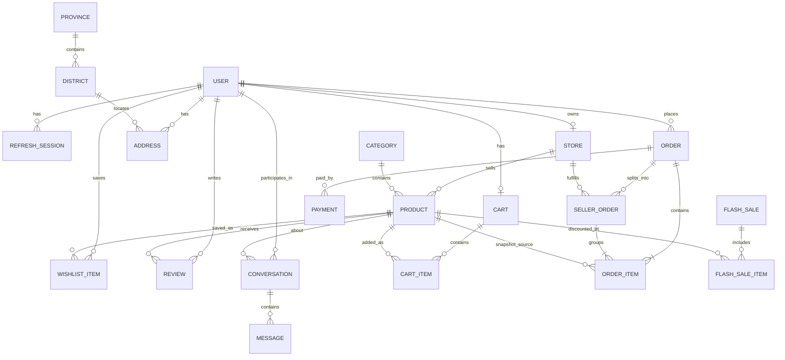

# SajiloMart — Conceptual ERD

> **Status:** Conceptual outline only — not a final database schema.
>
> Entities are introduced only when their features require them. The project
> owner will finalize the data model. Column lists, data types, and migration
> details are intentionally omitted until the corresponding sprint.

## 1. How to read this document

- This is a planning artifact to keep the incremental design coherent.
- It shows candidate entities and conceptual relationships, not tables to create
  now.
- Every schema change must use a TypeORM migration with working `up` and `down`
  operations. `synchronize` is always disabled.
- Before an entity is introduced, document: why it is needed, its relationships,
  constraints, indexes, migration requirements, and effect on existing features.

## 2. Entity introduction plan

| Entity | Introduced when | Purpose | Key relationships |
|---|---|---|---|
| `User` | Authentication | Account identity and role | Refresh sessions, addresses, cart, orders, reviews, store |
| `RefreshSession` | Authentication | Hashed refresh-token session and rotation | Belongs to user |
| `Category` | Product catalog | Catalog taxonomy | Has many products |
| `Product` | Product catalog | Sellable item | Belongs to category; optionally to store; referenced by cart, order, wishlist, review, flash sale |
| `Store` / `SellerProfile` | Seller onboarding | Seller identity and store data | Belongs to user; has many products and seller orders |
| `Province` | Delivery addresses | Top-level geography (7) | Has many districts |
| `District` | Delivery addresses | Second-level geography (77) | Belongs to province; referenced by addresses |
| `Address` | Checkout | Customer delivery address | Belongs to user and district |
| `Cart` | Cart | Active shopping cart | Belongs to user; has many cart items |
| `CartItem` | Cart | Product and quantity in cart | Belongs to cart and product |
| `Order` | Checkout | Customer-level order | Belongs to user; has many order items and seller orders; has payments |
| `OrderItem` | Checkout | Purchased item with snapshots | Belongs to order, product, and seller order |
| `SellerOrder` (or fulfillment group) | Multi-vendor orders | Seller-specific fulfillment unit | Belongs to order and store; has many order items |
| `WishlistItem` | Wishlist | Saved product | Belongs to user and product |
| `Review` | Reviews | Rating and review text | Belongs to user and product |
| `Conversation` | Messaging | Buyer-seller thread | Participants, optional product, many messages |
| `Message` | Messaging | Individual message | Belongs to conversation and sender |
| `FlashSale` | Promotions | Scheduled promotion | Has many flash-sale items |
| `FlashSaleItem` | Promotions | Product discount and limited quantity | Belongs to flash sale and product |
| `Payment` | Payment preparation | Payment record and state | Belongs to order |

## 3. Conceptual diagram

> The diagram is deliberately high-level. Cardinalities may be refined in the
> owning sprint, especially around carts, reviews, conversations, and payments.

## 4. Entity notes

### 4.1 User and authentication

- A single `User` entity carries the role (`CUSTOMER`, `SELLER`, `ADMIN`,
  `SUPERADMIN`).
- Public registration creates `CUSTOMER` only.
- `SELLER` is granted after an application and approval.
- `ADMIN` is created or assigned by `SUPERADMIN`.
- `SUPERADMIN` uses secure provisioning; never public registration.
- `RefreshSession` stores hashed refresh tokens, rotation state, expiry, and
  revocation data.
- Google OAuth identity links to an existing or newly created user through a safe
  linking process. Final linking rules are decided in the OAuth sprint.

### 4.2 Store and product ownership

- Products need an ownership path that can evolve to multi-vendor. The catalog
  sprint must introduce the smallest compatible design, documented before
  implementation.
- Once stores exist, a product belongs to exactly one seller store.
- Seller queries must always be scoped by the authenticated seller's store.
- Admins may manage all products within implemented permissions.

### 4.3 Geography and addresses

- `Province` has many `District` rows; every district belongs to exactly one
  province.
- Seed data must contain exactly 7 provinces and 77 districts, verified by a
  repeatable check.
- Geography is data only. There are no province or district administrative roles.
- Address rows reference a district and belong to a customer.

### 4.4 Cart

- Cart is user-scoped and persistent.
- Cart items reference products and carry quantity.
- Totals are calculated by the backend; the frontend never defines the charged
  amount.
- Stock is validated at cart mutation and again at checkout.

### 4.5 Orders and snapshots

- `Order` represents the customer's complete purchase.
- `OrderItem` stores immutable snapshots of product name, unit price, quantity,
  and any other fields needed to preserve history.
- Delivery address is snapshotted onto the order.
- Multi-vendor orders use a parent order plus seller-specific suborders or
  fulfillment groups. The exact model is decided and documented in the
  multi-vendor sprint.
- Inventory updates and order creation occur in transactions.
- Status changes must be valid transitions; invalid transitions are rejected.

### 4.6 Reviews

- One customer may review a given product once; enforce with a unique constraint.
- Verified-purchase checks use order history.
- Reviews may be moderated by admins when that feature exists.
- Public reading does not require authentication; submission does.

### 4.7 Messaging

- Conversations are scoped to participants.
- Messages belong to a conversation and a sender.
- Product association is optional.
- Access is denied to non-participants and unauthorized roles.

### 4.8 Flash sales and payments

- Flash sales have a schedule and state derived from time: upcoming, active, or
  expired.
- Flash-sale quantities are limited and validated against stock.
- `Payment` is prepared in the payment sprint.
- Cash on Delivery remains functional.
- No order is marked paid without verified provider confirmation.
- Stripe webhook handling must be idempotent and transactional.

## 5. Cross-cutting data rules

- Use appropriate foreign keys, indexes, and unique constraints.
- Use correct decimal precision for monetary values; never use floating point for
  money.
- Include created/updated timestamps where useful.
- Prefer safe deletion strategies (soft delete or restricted deletion) over
  destructive cascades for historical records.
- Preserve order history with snapshots even if the product or address changes.
- Avoid N+1 queries; use deliberate joins or batched queries.
- Example uniqueness candidates: user email, province/district codes, one cart
  per user, one review per customer per product, one wishlist row per
  customer/product.
- Final index choices are made per sprint with the query patterns in mind.

## 6. Migration expectations

For every entity introduction or change:

1. Write the migration with `up` and `down`.
2. Add constraints and indexes in the same migration when appropriate.
3. Verify it applies cleanly to a fresh database.
4. Verify `down` reverts it.
5. Verify existing data is preserved for non-destructive changes.
6. Update this document and the implementation log.

## 7. Open data-model decisions

- Primary key strategy (auto-increment integer vs. UUID).
- Product image storage (files vs. object storage).
- Whether `SellerOrder` or a more general `Fulfillment` naming is used.
- Cart behavior when a product is removed or unpublished.
- Soft-delete scope for users, products, and stores.
- Exact address snapshot fields.
- Payment provider reference storage.

These are tracked in [`DECISIONS_LOG.md`](./DECISIONS_LOG.md).
